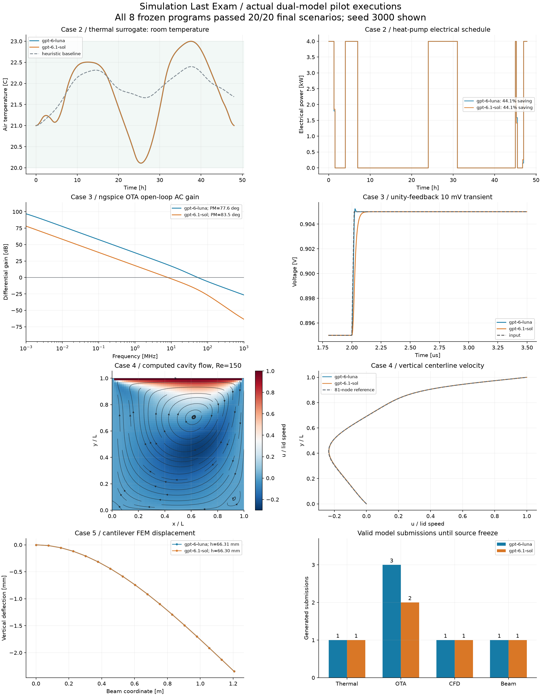

# 四个工程仿真 case：双模型首轮评测

通过用户指定服务实际调用 `gpt-6-luna` 和 `gpt-6.1-sol`，统一使用 `high` 推理强度。
下表是冻结的模型代码在 20 个新工况上的独立验收成绩，括号中为 API 生成提交次数。

| Case | gpt-6-luna | gpt-6.1-sol |
|---|---:|---:|
| building | 20/20（1 次提交） | 20/20（1 次提交） |
| circuit | 20/20（3 次提交） | 20/20（2 次提交） |
| cfd | 20/20（1 次提交） | 20/20（1 次提交） |
| structure | 20/20（1 次提交） | 20/20（1 次提交） |

## 统一协议

每个模型、每个 case 使用独立的新 API 上下文。输入只含公开题目、故障代码、3 个开发工况和真实失败反馈。
最多允许 3 版模型提交；开发集首次 3/3 时冻结，否则冻结第 3 版。提交源码未经主控手工修复。
开发种子 0、1、2；验收种子 3000–3019。验收反馈未回传给模型。
两个模型使用相同的任务、种子、共享求解器、工具权限和预算。单个 case 的 20 个工况不构成 20 个任务族。
电路代码可在每个工况使用最多 12 次原生 ngspice 查询，再由独立调用验收最终尺寸；其余 case 无运行时工具。
API key 只存在于进程内存与认证头中，未保存在工程代码、请求存档、报告或结果中。

## 四个 case 实际采用的仿真

- **建筑**：本地两节点空气/地板热模型与热泵、48 小时全预测电价调度。精确离散状态方程与独立 ODE 积分交叉核对。
  要求功率和舒适性约束、终态储能约束全部满足，费用较给定启发式基线降低至少 5%。这是降阶试验版，**不是原生 BOPTEST**。
  上游热泵 FMU 仅带 Linux 二进制，本机 WSL 无法使用，故采用明确标注的可复算替代模型。
- **电路**：官方 ngspice 47 Windows 程序，固定两级 Miller OTA，MOS LEVEL=1 教学器件模型。实际执行工作点、交流和闭环瞬态。
  同时验收增益、单位增益带宽、相位裕度、功耗、偏置、稳态误差和过冲。**不是 SKY130/ADB 的完整复现**。
- **CFD**：本地二维流函数–涡量有限差分 Navier–Stokes 求解器，33/49/65 三档网格，对比 81 网格参考。
  检查物理黏度转换、边界、速度剖面误差、网格变化、散度和稳态残差。**不是 OpenFOAM/FoamBench 分数**。
  只有 Re=50/100/150 三个无量纲流态；20 个工况主要变化尺寸、速度和密度，评估量纲与配置处理。
- **结构**：Euler–Bernoulli 梁有限元、相容质量矩阵、静力与首阶模态，4/8/16 三档网格，并与梁解析解交叉核对。
  模型需自行计算结果并选取满足位移、应力和频率约束的截面，高度/质量不得超过解析最优值 2%。**未调用 CalculiX/OpenSees**。

## 证据与限制

题目、阈值和验收器先经参考实现校准：每域 3 个开发工况及 20 个验收工况均存在合格参考方案；四个故障起始代码均为 0/3。
参考实现只用于检查题目可解性，不会作为模型成绩，也不放进 API 输入。
建筑用独立 ODE 积分验证精确离散化；结构用解析解验证有限元；CFD 用制造解验证 Poisson 离散并检查网格收敛；电路核对 ngspice 重复运行。
CFD 的 81 网格比较采用同一求解器，不是独立实验数据验证；全部 case 属于数值验证级证据。

AST 限制及进程超时仅用于合作式代码执行，不是恶意代码的系统级沙箱。
模型身份按请求值及服务回报值记录，未独立验证第三方服务的内部权重。此次为单轮、单任务族诊断，不作为完整 benchmark 排名。

## 本地文件

工程根目录：`[local source evidence]`

每个 case 的 `public/` 保存模型题目与故障代码。
本轮目录内每个 `case/model/` 保存无凭据的 request/response、每版源码、开发结果、冻结源码、最终逐工况结果和原始仿真证据。
统一协议 `protocol.json`；完整结果 `results.json`；求解器校准 `benchmark/calibration/validation.json`。
`run_four_cases.ps1` 可重新调用两个模型启动新一轮；`reproduce_four_cases.ps1` 只重跑冻结代码，无须 API key。

## 补充诊断与复核

| Case | 模型 | 开发成功数（各版 /3） | 验收 | 有效提交次数 |
|---|---|---|---:|---:|
| building | gpt-6-luna | 3/3 | 20/20 | 1 |
| building | gpt-6.1-sol | 3/3 | 20/20 | 1 |
| circuit | gpt-6-luna | 0/3 → 0/3 → 3/3 | 20/20 | 3 |
| circuit | gpt-6.1-sol | 0/3 → 3/3 | 20/20 | 2 |
| cfd | gpt-6-luna | 3/3 | 20/20 | 1 |
| cfd | gpt-6.1-sol | 3/3 | 20/20 | 1 |
| structure | gpt-6-luna | 3/3 | 20/20 | 1 |
| structure | gpt-6.1-sol | 3/3 | 20/20 | 1 |

共获得 11 份有效模型源码。另有 3 次服务并发限制返回，无生成内容；原始失败响应已保存在 transport_failures/。恢复时串行重发原输入，没有增加有效提交预算，也未修改源代码或求解器。

电路两模型第一版均因使用禁止的 getattr 反射入口而未执行；luna 第二版又将字典当作对象访问。真实错误反馈后由模型自行修复。因此这些开发失败首先反映代码接口与约束遵循，不能直接解释为模拟电路理论设计能力差。

本轮全部最终工况都成功，当前任务难度和允许工具未形成最终通过率差异。不能据此给两个模型排出稳定的能力高低；后续应增加任务族、规格冲突、不同拓扑/几何和重复试验。

CFD 对相同无量纲工况及相同求解设置使用数值缓存；20 个量纲变体仍只有三个无量纲流场，不能当作 20 个独立流态。建筑则是全预测开环调度，不是带预测误差的闭环 MPC。

`gpt-6-luna`：建筑平均费用改善 46.0%；OTA 最低增益 103.53 dB、最低单位增益带宽 43.27 MHz、最低相位裕度 69.95°，每工况平均运行时查询 12.0 次（另加一次独立验收）；梁最大质量/解析最优质量 1.000200。

`gpt-6.1-sol`：建筑平均费用改善 46.0%；OTA 最低增益 101.49 dB、最低单位增益带宽 7.95 MHz、最低相位裕度 82.32°，每工况平均运行时查询 1.0 次（另加一次独立验收）；梁最大质量/解析最优质量 1.000100。

已对每组冻结程序独立重跑种子 3000、3010、3019，共 24/24 个工况成功标记与原验收一致。复跑未调用模型 API。

证据核查：33 项均通过；已核对全部源码与 API 原文、冻结哈希、160 个回合，以及电路原始交流/瞬态数据。工程文本扫描未发现 API key 格式。

